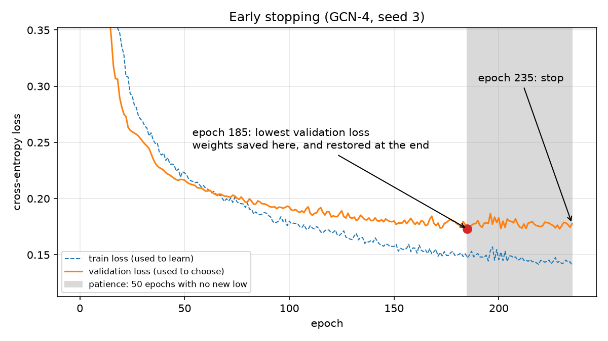
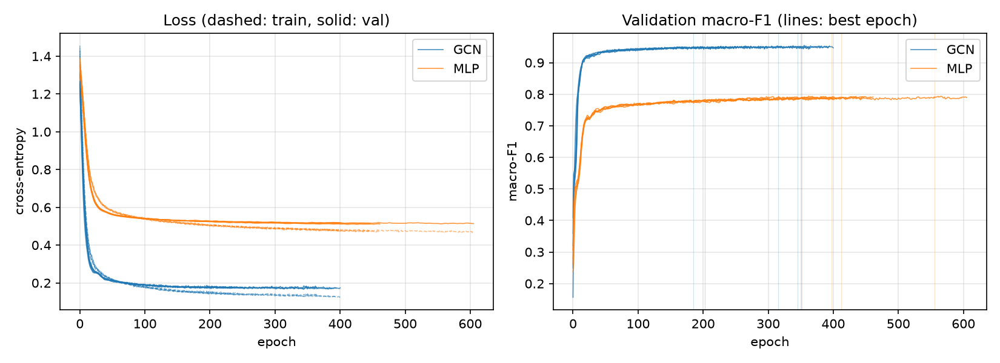
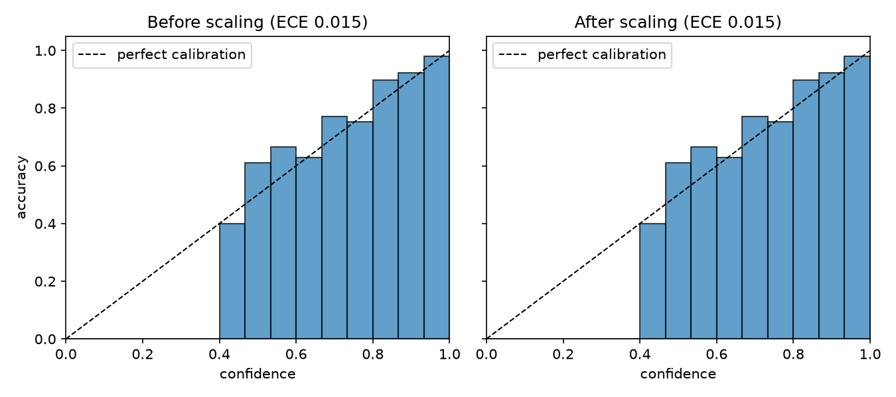
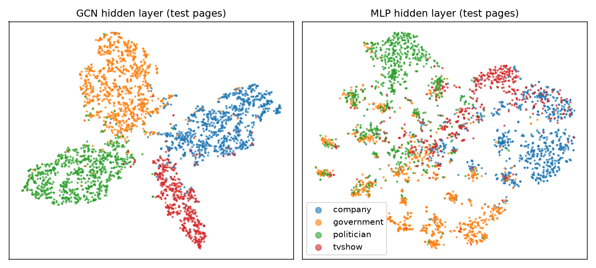
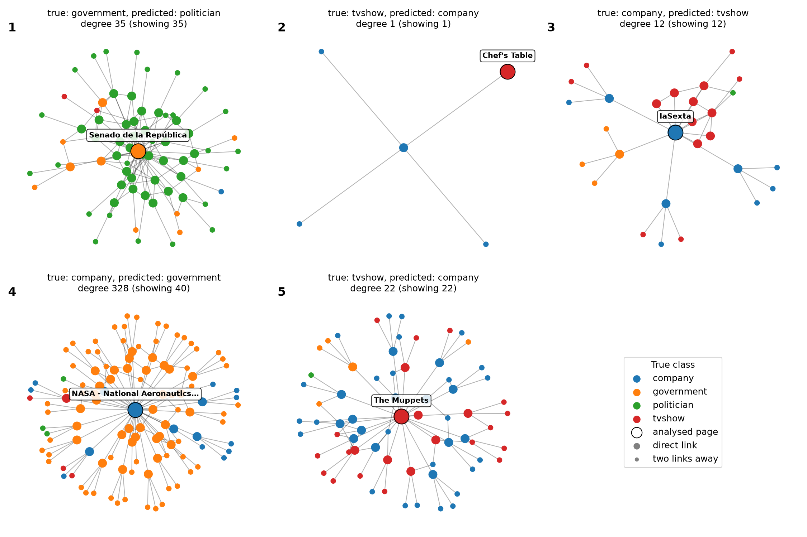

# Multi-layer GCN for Facebook Page-Page Node Classification

**Student number:** 49250523 · **Project:** 2.1 Classification · **Model:** multi-layer GNN (GCN) · **Difficulty:** Normal

> **Status (23 Oct 2026):** all experiments are complete. AC1, AC2, AC4 and AC5 pass; AC3 fails narrowly (Section 7.4).

**At a glance** (held-out test split, mean over 5 training seeds):

| | GCN-4 (chosen) | MLP baseline (no graph) |
|---|---|---|
| Macro-F1 | **0.945 ± 0.002** | 0.776 ± 0.004 |
| Accuracy | 0.948 | 0.798 |
| TV-show recall (minority class) | 0.917 | 0.560 |
| Calibration error (ECE), before → after temperature scaling | 0.014 → 0.015 | 0.036 → 0.034 |
| Reject rule: pages auto-labelled / their accuracy | 95.3 % / 96.3 % (target ≥ 97 %) | 44.4 % / 95.7 % |
| Parameters / full-graph inference (CPU) | 16,836 / 58 ms | 8,516 / 1.2 ms |

**Recommendation:** pilot the GCN with human review of low-confidence pages. Where to set the threshold is a trade-off between manual reviews and wrong labels, so it should follow the client's review capacity and the cost of a wrong label (operating points in Section 7.9). Discussion of what the results mean: Section 7.8.

## Contents

1. [Problem and algorithm](#1-problem-and-algorithm)
2. [Feasibility review](#2-feasibility-review)
3. [Data, preprocessing and split](#3-data-preprocessing-and-split)
4. [Models](#4-models)
5. [Training and hyperparameter tuning](#5-training-and-hyperparameter-tuning)
6. [Leakage controls](#6-leakage-controls)
7. [Results](#7-results)
8. [Usage](#8-usage)
9. [Dependencies](#9-dependencies)
10. [Code structure and style](#10-code-structure-and-style)
11. [Project log](#11-project-log)
12. [Limitations](#12-limitations)
13. [References](#13-references)
14. [Artificial Intelligence Usage Disclosure](#14-artificial-intelligence-usage-disclosure)

---

## 1. Problem and algorithm

**Problem.** The Facebook Large Page-Page network has 22,470 verified Facebook pages. Two pages are linked when they like each other. Each page has a 128-dimensional feature vector built from its description, and one of four categories: company, government, politician or TV show. The task is semi-supervised node classification: predict the category of pages whose labels are withheld. The engineering question is whether the model's **confidence** can be trusted, so that a triage system can auto-label the pages it is sure about and send the rest to a human.

**How a GCN works.** A graph convolutional network (Kipf & Welling, 2017) updates every page at once. In each layer, each page takes a degree-normalised weighted sum of its own features and its neighbours' features (close to an average, but the weights do not sum exactly to 1), then multiplies the result by a weight matrix that is shared by all pages. In matrix form, one layer is:

$$H^{(l+1)} = \mathrm{ReLU}\left(\tilde D^{-1/2} \tilde A \tilde D^{-1/2} H^{(l)} W^{(l)}\right), \qquad \tilde A = A + I$$

<details>
<summary>Symbols</summary>

| Symbol | Meaning | Size in this project |
|---|---|---|
| $N$ | Number of pages (nodes) | 22,470 |
| $l$ | Layer number, from $0$ to $L-1$ | $L = 4$ layers |
| $H^{(l)}$ | Input to layer $l$: one row of numbers per page. $H^{(0)} = X$, the 128 input features of each page | $N \times 128$ for layer 0, then $N \times 64$ |
| $W^{(l)}$ | Weight matrix of layer $l$, **learned** in training and **shared by every page** | $128 \times 64$, then $64 \times 64$, last $64 \times 4$ |
| $A$ | Adjacency matrix: $A_{ij} = 1$ if pages $i$ and $j$ are linked, else $0$ | $N \times N$ (stored as an edge list, because 99.9 % of entries are 0) |
| $I$ | Identity matrix: $1$ on the diagonal, $0$ elsewhere | $N \times N$ |
| $\tilde A = A + I$ | Adjacency **with self-loops**: each page is also linked to itself, so its own features stay in its weighted sum | $N \times N$ |
| $\tilde d_i$ | Degree of page $i$ in $\tilde A$: its number of links **plus 1** (the self-loop) | 2 to 710 here |
| $\tilde D$ | Degree matrix: diagonal, with $\tilde D_{ii} = \tilde d_i$ | $N \times N$ |
| $\tilde D^{-1/2}$ | Diagonal matrix with entries $1/\sqrt{\tilde d_i}$ | $N \times N$ |
| $\mathrm{ReLU}$ | $\max(0, x)$ on each number; not used after the last layer | – |

</details>


---

## 2. Feasibility review


### 2.1 User need, scope and acceptance criteria

**User:** a page-categorisation team that must classify pages whose features and links are known but whose category is withheld. **Purpose:** a triage assistant that auto-labels pages it is confident about and sends ambiguous pages to a human reviewer. The open question is whether confidence tracks correctness, so the criteria test calibration and the reject option, not only accuracy.

| # | Acceptance criterion (on the held-out test split) |
|---|---|
| AC1 | Macro-F1 ≥ 0.90 and ≥ 0.05 above the MLP baseline on the same split. |
| AC2 | Expected calibration error (top-label ECE, 15 equal-width bins) ≤ 0.03 after temperature scaling fitted on validation only. |
| AC3 | Reject rule: choose the threshold (the minimum confidence score a page needs to be auto-labelled) with the highest validation coverage subject to ≥ 97 % validation accuracy, then freeze it. On test: auto-label ≥ 80 % of pages at ≥ 97 % accuracy. |
| AC4 | No leakage: train/validation/test masks are disjoint; only training labels enter the loss; every model, calibration and threshold choice uses validation results. |
| AC5 | Resources: one full training ≤ 10 min and peak memory ≤ 4 GB on a laptop CPU; full-graph inference ≤ 1 s. |


### 2.2 Model choice and course concepts

**Data:** the course-specified release (`gayanku/facebook_page-page_dataset`, `facebook.npz`): 22,470 pages, 170,823 undirected mutual-like edges after removing 179 self-loops, 4 classes, 128-dimensional SVD features. **Setting:** transductive semi-supervised classification on a stratified, seeded 70/15/15 node split. All features and edges are visible during message passing; only training labels are used for learning. **Model:** a multi-layer GCN with dropout and residual connections (spec Section 2.1, "Multi-layer GNN", **Normal difficulty**). **Baseline:** a 2-layer MLP on the same features with no graph. **Course link:** GCN layers are a first-order approximation of spectral graph filters, i.e. the Fourier and convolution ideas from the course applied to a graph Laplacian. Connected pages share a label on 88.5 % of edges, which supports neighbour averaging. Calibration uses temperature scaling (Guo et al., 2017).

### 2.3 Preliminary evidence (smoke test, 21 Oct 2026, seed 42, Apple M4 CPU)


| Model | Test acc. | Macro-F1 | AUROC (macro OvR) | ECE (uncalibrated) | Mean confidence right / wrong | Coverage at confidence ≥ 0.9 → accuracy | Params | Train time |
|---|---|---|---|---|---|---|---|---|
| MLP | 0.797 | 0.775 | 0.947 | 0.041 | 0.83 / 0.57 | 45 % → 0.964 | 8.5 k | 1.5 s |
| GCN | 0.928 | 0.924 | 0.988 | 0.035 | 0.91 / 0.68 | 68 % → 0.979 | 8.5 k | 12 s |
| GAT | 0.936 | 0.932 | 0.990 | 0.021 | 0.93 / 0.72 | 76 % → 0.981 | 8.7 k | 23 s |
| GIN | 0.939 | 0.935 | 0.991 | 0.018 | 0.95 / 0.74 | 83 % → 0.979 | 16.8 k | 15 s |

"Confidence" is the highest predicted class probability; "coverage" is the fraction of pages auto-labelled. Peak memory was 0.88 GB. **Takeaways:** the graph adds 14.9–16.0 macro-F1 points over the MLP. GAT and GIN beat the GCN by only 0.8 and 1.1 points, from one seed, at up to 1.9× the training time. These test scores are exploratory: they informed the design, so the final study uses a fresh split (Section 3.3).

### 2.4 Risks, budget and fallback

- **Data quirks:** the dataset README gives the wrong label order. The labels are alphabetical (company, government, politician, tvshow), verified for all 22,470 pages against the MUSAE target file. The file holds 179 self-loops (358 entries), which are removed. The pickled `page_name` array is skipped for safety; names come from the MUSAE CSV.
- **Over-smoothing** in deeper GCNs can blur class boundaries; depth is tuned and residual connections are used.
- **Small gaps:** results are reported as mean ± standard deviation over 5 training seeds. TV show has the lowest F1 for every model; the failure analysis studies 3–5 such pages.
- **Budget:** each run takes seconds to minutes on a laptop CPU, so no cluster is needed.
- **Next experiment:** GCN, GAT and GIN over 5 seeds at 2/3/4 layers, then temperature scaling, a reliability diagram, a validation-chosen threshold and a t-SNE plot of the embeddings.
- **Fallback:** the 2-layer GCN already passes AC1. If GAT or GIN don't beat it clearly over 5 seeds, I'll keep the GCN as the cheapest model and focus on calibration and the reject-option analysis.


### Revisions since the check-off

<details>
<summary>What changed in the review after the check-off, and why</summary>

| Change | Reason |
|---|---|
| Scope reduced to **GCN vs MLP** (GAT and GIN dropped) | The GCN passes AC1. GAT and GIN gained ≤ 1.1 points from one seed at up to 1.9× the cost, so the GCN is the cheapest model that meets the need. Their smoke-test rows stay as evidence for this choice. |
| "358 self-loops" → **179 self-loops (358 entries)** | Each self-loop appears twice in the edge list. The edge count (170,823) was already correct. |
| AC2, AC3, AC4 reworded | AC3 now states the exact threshold rule; AC4 states what can be checked in code. (Suggested by an AI review, see Section 14.) |
| User need reworded | "Newly verified pages" implied an inductive setting; the study is transductive. |
| Table labels | ECE and confidence are marked as uncalibrated; confidence and coverage are defined. |
| Homophily claim narrowed | "Message passing assumes homophily" overstated the theory; the measured 88.5 % is now given as support. |

</details>

---

## 3. Data, preprocessing and split

### 3.1 Source

`facebook.npz` from [gayanku/facebook_page-page_dataset](https://github.com/gayanku/facebook_page-page_dataset), built from MUSAE (Rozemberczki et al., 2021). `dataset.py` downloads it once and checks its SHA-256 hash. It is not committed.

| Array | Shape | Content |
|---|---|---|
| `X` | 22,470 × 128 | SVD features of page descriptions |
| `edges_x`, `edges_y` | 342,004 | directed pairs (both directions of each link) |
| `y` | 22,470 | labels 0–3 |
| `page_name` | 22,470 | **skipped**: pickled object array |

### 3.2 Preprocessing

| Step | Why |
|---|---|
| `np.load(..., allow_pickle=False)` | A pickled array can run code when loaded. Only numeric arrays are read. |
| Remove 179 self-loops (358 entries) | A page liking itself is not a relation. GCNConv adds its own self-loop in a controlled way. |
| `to_undirected` (also merges duplicates) | Links are mutual likes; both directions must exist. Result: 170,823 undirected edges. |
| Check for NaNs and size mismatches | Raises `ValueError` instead of training on bad data. |
| Labels | the dataset README says that label numbers [0, 1, 2, 3] correspond to [tvshow, government, company, politician], but they actually correspond to [company, government, politician, tvshow]. |


### 3.3 Split

**Setting: transductive.** All 22,470 pages and all edges are present during training, as in a real platform where every page exists but only some are labelled. Every page's **features and links** go through the forward pass, so each page can average over all its neighbours. The split decides only **whose labels** may be used, and for what:

| Split | Pages | How its labels are used | Results |
|---|---|---|---|
| Train (70 %) | 15,729 |  Only these labels enter the cross-entropy loss. Backpropagation computes the gradient of that loss, and Adam uses it to update the weights $W$. | Train loss curve, [Section 7.1](#71-test-macro-f1-ac1) |
| Validation (15 %) | 3,370 | These labels never update the network weights $W$. They are read after each epoch with no gradient, for early stopping ([5.1](#51-training)) and picking the hyperparameters ([5.4](#54-tuning-history)). After training they fit two post-hoc values: the temperature and the reject threshold ([7.4](#74-reject-option-ac3)). | [Section 5.4](#54-tuning-history) |
| Test (15 %) | 3,371 |  Test page labels are set to −1 during training and tuning ([Section 6](#6-leakage-controls)), then the model's predictions for those pages are compared with their labels after hyperparameter tuning is complete and the minimum confidence threshold and temperature have been decided. | [Sections 7.1–7.7](#7-results) |

A training page and a test page can be neighbours. The test page's features then flow into the training page's average, but its **label** never does. This is the standard transductive protocol (Kipf & Welling, 2017).

- Stratified so every split has the same class ratios.
- Shuffled with a fixed split seed to break hidden patterns in test data while making results reproducible.
- **Fresh split seed (3710).** The smoke test used seed 42 and its test scores informed the design, so the final study uses a new split, to ensure results were not biased towards a random pattern in the test splits.

### 3.4 Augmentation

`augment()` implements DropEdge (Rong et al., 2020): on each training step it removes a random fraction of edges, both directions together. It is used on training passes only and never touches labels. 

---

## 4. Models


| Model | Architecture | Params |
|---|---|---|
| MLP (baseline) | 128 → 64 → 4, ReLU, dropout; ignores edges | 8,516 |
| GCN-2 | 128 → 64 → 4 | 8,516 |
| GCN-3 | 128 → 64 → [64 → 64 + residual] → 4 | 12,676 |
| GCN-4 | 128 → 64 → [64 → 64 + residual] × 2 → 4 | 16,836 |
| GCN-8 | 128 → 64 → [64 → 64 + residual] × 6 → 4 | 33,476 |

The MLP has the same width, depth and dropout as GCN-2, so the gap between them measures the value of the graph. Residual connections between hidden layers ($h \leftarrow h + \mathrm{conv}(h)$, Kipf & Welling, App. B) let deeper models keep each page's own signal instead of averaging it away (over-smoothing).

**Dropout placement.** No model applies dropout to the input features. Dropout is applied to the hidden representation before every layer after the first, as in the smoke test:

- MLP: `ReLU(Linear(x)) → dropout → Linear`
- GCN-2: `ReLU(GCNConv(x)) → dropout → GCNConv`
- GCN-3, -4 and -8: `h = ReLU(GCNConv(x))`, then each middle layer computes `h = h + ReLU(GCNConv(dropout(h)))` (dropout sits inside the residual branch), then `dropout → GCNConv` gives the 4 outputs.

---

## 5. Training and hyperparameter tuning

### 5.1 Training

**One epoch = one step.** The whole graph fits in memory, so each epoch is completed in a single batch:

```
forward pass (all 22,470 pages) → cross-entropy loss on the 15,729 training labels
→ backpropagation (gradient of the loss for every weight) → one Adam update of W
→ validation loss on the 3,370 validation labels (no gradient, no update)
```

**Early stopping** (Shchur et al., 2018). Training loss falls almost every epoch, because the weights are updated to lower it. Validation loss shows how well the model does on labels it does not learn from. It falls at first, then flattens. If training went on, the model would start to fit details of the training pages that do not carry over to other pages (overfitting), and validation loss would rise. So the final model is not the weights at the last epoch:

1. After each epoch, if the validation loss is a **new lowest value**, keep a copy of the weights from that epoch.
2. If 50 epochs pass with no new lowest value (the **patience**), stop.
3. Load the saved copy. The model that is tested is the one from the **best epoch**, not the last one.



**Figure.** A real run (GCN-4, seed 3, the first final run). Validation loss reaches its lowest value, 0.173, at epoch 185, and those weights are saved. In the next 50 epochs (grey), validation loss only wobbles (up to 0.187) and never goes lower, while training loss keeps falling (0.147 → 0.141). The gap between the two lines grows: the model is starting to fit the training pages more than the other pages. Training stops at epoch 235 and the epoch-185 weights are restored. The 50 extra epochs cost about 9 s and are thrown away. The cap of 100,000 epochs was never reached; the best epochs in all final runs were 185–556 ([Section 7.1](#71-test-macro-f1-ac1)).

### 5.2 Sources for every hyperparameter

Three papers supply every value.

| Key | Paper | Why it is used |
|---|---|---|
| **[K]** | Kipf & Welling (2017), *Semi-supervised classification with graph convolutional networks* | The GCN |
| **[S]** | Shchur et al. (2018), *Pitfalls of graph neural network evaluation* | Comparison of GCN and MLP |
| **[R]** | Rong et al. (2020), *DropEdge* | Deeper GCNs and dropping edges |

**Tuned on validation:** layers {2, 3 [K]; 4, 8 [R]}, dropout {0.5 [K], 0.8 [S]}, DropEdge {0 [K], 0.3 [R]}, learning rate {0.01 [K, S], 0.005 [S]}: 32 GCN and 4 MLP settings. **Fixed:** hidden size 64 [S], weight decay 5 × 10⁻⁴ [K], Adam [K, S], early stopping with patience 50 [S].

Full references: [Section 13](#13-references).


### 5.3 Protocol

Two kinds of seed are used (Section 3.3). The **split seed** (3710) is fixed and decides which pages are in train, validation and test. **Model seeds** decide the random start weights, dropout and DropEdge patterns. Each model seed is a different, equally valid training run of the same setting.

1. **Tune (validation only).** A *setting* is one combination of hyperparameter values, e.g. "4 layers, dropout 0.5, *p* = 0, learning rate 0.01". Every setting is trained 3 times, with model seeds 0, 1 and 2, and scored on validation. The setting with the highest **mean** validation macro-F1 over its 3 runs is chosen ([S] also selects by mean validation score).
2. **Final (test).** The chosen setting is trained again with **new** model seeds 3, 4, 5, 6 and 7. Each of the 5 models is scored on test once. All 5 scores are reported, as mean ± standard deviation and one by one ([Section 7.1](#71-test-macro-f1-ac1)).


### 5.4 Tuning history

Each table row is one setting. **Validation macro-F1: mean** is the average of its 3 runs (model seeds 0, 1, 2); **std** is the standard deviation of those 3 runs, i.e. how much the score changes with the seed. Each version has one table per model, because the best setting is chosen separately for each model. 

**Summary: best v2 setting for each depth** (the full tables follow, collapsed):

| Model | Layers | Dropout | DropEdge *p* | Learning rate | Validation macro-F1 (mean ± std, seeds 0–2) | Best epoch of each seed | Rank in its grid |
|---|---|---|---|---|---|---|---|
| GCN | 8 | 0.5 | 0 | 0.005 | 0.9510 ± 0.0018 | 371, 390, 311 | 2 of 32 |
| **GCN (chosen)** | **4** | **0.5** | **0** | **0.01** | **0.9517 ± 0.0007** | 311, 363, 314 | 1 of 32 |
| GCN | 3 | 0.5 | 0 | 0.01 | 0.9470 ± 0.0019 | 474, 317, 467 | 9 of 32 |
| GCN | 2 | 0.5 | 0 | 0.005 | 0.9271 ± 0.0011 | 809, 806, 885 | 25 of 32 |
| MLP | 2 | 0.5 | – | 0.01 | 0.7852 ± 0.0008 | 458, 373, 319 | 1 of 4 |

Tuning ran twice, on validation only. v1 capped training at 200 epochs, but almost every run had its best epoch at 185–200 and the best depth (4) was at the edge of the grid. v2 replaced the epoch cap with early stopping before 100000 epochs and added 8 layers. v2 chose the same settings: 4 layers, dropout 0.5, no DropEdge, learning rate 0.01. 8 layers were no better than 4 (0.9510 vs 0.9517, within seed noise); DropEdge and dropout 0.8 lowered the score at every depth; learning rate mattered little.

**v1 (22 Oct, superseded).** 24 GCN + 4 MLP settings × 3 seeds = 84 runs. Each run trained for at most 200 epochs ([K]), keeping the epoch with the lowest validation loss. Full results: [`results/tuning_v1.json`](results/tuning_v1.json), [`results/tuning_v1.log`](results/tuning_v1.log).

Two problems led to v2:

1. **The epoch limit cut training short.** Almost every run had its best epoch between 185 and 200, so validation loss was still falling at the limit. This also favoured settings that learn fast (learning rate 0.01, dropout 0.5). Fix: [S]'s early stopping (patience 50, max 100,000 epochs, Section 5.1).
2. **The best depth was at the edge of the grid.** Mean validation macro-F1 still rose from 2 to 3 to 4 layers. Fix: add 8 layers, the next depth tested by [R].

**v2 (22 Oct, final).** 32 GCN + 4 MLP settings × 3 seeds = 108 runs, with early stopping. Total 136 min on the M4 CPU. Full results: [`results/tuning.json`](results/tuning.json), [`results/tuning_v2.log`](results/tuning_v2.log).

What v2 shows:

1. **Early stopping fixed the cut-off.** Best epochs are now 226–992, all past the old limit of 200 and far below the 100,000 cap. 
2. **Depth peaks at 4 layers.** The best 8-layer setting (0.9510) is not better than the best 4-layer setting (0.9517), so the best depth is no longer at the edge of the grid.
3. **DropEdge (*p* = 0.3) and dropout 0.8 lowered the score** for every GCN depth, as in v1.
4. **Learning rate matters little.** For each pair of settings that differ only in learning rate, the scores are within 0.002.
5. **Seed spread is small.** The std is at most 0.0041, and the gap between the top two GCN settings (0.0007) is no larger than the std of either.

Most of the gap between GCN and MLP (+0.167 macro-F1) comes from the graph: GCN-2, the same size as the MLP, already gains +0.142. The extra depth of GCN-4 adds the rest. 

---

## 6. Leakage controls

| Control | Where | What happens on a violation |
|---|---|---|
| Disjoint masks that cover every node | `dataset.check_split` | `ValueError` |
| Test labels replaced by −1 during training and tuning | `train.hide_test_labels` | `cross_entropy` raises `IndexError` if a test page enters the loss |
| No scoring of hidden labels | `train.evaluate` | `ValueError` |
| Test scored only after all choices are frozen: in `final`, then again on the same checkpoints by `predict.py` | `train.final`, `predict.main` | – |
| Temperature and threshold fitted on validation only, then frozen | `predict.score_seed` (uses `calibrate.py`) | – |
| Fresh split seed after the exploratory smoke test | `dataset.SPLIT_SEED` | – |

In the transductive setting, test pages' **features and edges** are visible during message passing; their **labels** are not. This is the standard protocol (Kipf & Welling, 2017).

**AC4 passes.** Every control above is in the code, and the split check was confirmed during development to raise `ValueError` on a planted overlap. The one known weakness is the 491 test pages shared with the smoke test.

---

## 7. Results

### 7.1 Test macro-F1 (AC1)

The tuned setting of each model (Section 5.4) was trained with new seeds 3–7 and scored on the test split (one score per seed). Full output: [`results/final.json`](results/final.json), [`results/final.log`](results/final.log).

| Model | Test macro-F1 (mean ± std, 5 seeds) | Per seed | Params | Train time / run | Best epochs |
|---|---|---|---|---|---|
| GCN-4 | **0.945 ± 0.002** | 0.943, 0.947, 0.942, 0.946, 0.946 | 16,836 | 53 s | 185–351 |
| MLP | 0.776 ± 0.004 | 0.781, 0.779, 0.773, 0.771, 0.778 | 8,516 | 4 s | 350–556 |

**AC1 passes:** 0.945 ≥ 0.90, and the GCN is 0.168 above the MLP (target ≥ 0.05). The worst GCN seed (0.942) is still 0.161 above the best MLP seed (0.781). Test is about 0.007 below validation (0.952), a small drop, which is expected as hyperparameters were chosen based on results of the validation pages.



**Figure.** Loss and validation macro-F1 for the 5 final seeds. Seeds agree closely. The GCN validation loss flattens by about epoch 200 and early stopping ends each run 50 epochs after its best epoch (vertical lines). The gap between train and validation loss stays small, so there is little overfitting.

### 7.2 Per-class metrics

From `python predict.py` ([`results/predict.json`](results/predict.json)). Mean over seeds 3–7; standard deviations are ≤ 0.01 (the largest is GCN TV-show recall, 0.0095).

| | Accuracy | Macro-F1 | AUROC (macro OvR) |
|---|---|---|---|
| GCN-4 | 0.948 | 0.945 | 0.990 |
| MLP | 0.798 | 0.776 | 0.946 |

| | company | government | politician | tvshow |
|---|---|---|---|---|
| GCN-4 precision / recall | 0.949 / 0.943 | 0.948 / 0.957 | 0.963 / 0.962 | 0.922 / 0.917 |
| GCN-4 F1 | 0.946 | 0.952 | 0.962 | 0.919 |
| MLP precision / recall | 0.829 / 0.848 | 0.802 / 0.844 | 0.777 / 0.825 | 0.759 / **0.560** |
| MLP F1 | 0.838 | 0.823 | 0.800 | **0.645** |

F1 is computed per seed, then averaged. TV show, the minority class (15 %), is the weakest class for both models. The graph helps it the most: recall rises from 0.56 to 0.917, and F1 from 0.645 to 0.919.

**Confusion matrix** (GCN-4, test pages summed over seeds 3–7, so each page counts 5 times; rows are the true class, columns the prediction):

| True ↓ / predicted → | company | government | politician | tvshow | Pages × 5 |
|---|---|---|---|---|---|
| company | **4,595** | 121 | 19 | 140 | 4,875 |
| government | 73 | **4,937** | 124 | 26 | 5,160 |
| politician | 9 | 128 | **4,159** | 29 | 4,325 |
| tvshow | 167 | 23 | 17 | **2,288** | 2,495 |

Most errors fall into three pairs: company ↔ tvshow (307 over the 5 seeds), government ↔ politician (252) and company ↔ government (194). The other confusions are small (for example politician → company, 9). The first two are the overlaps seen in the t-SNE plot (Section 7.5), and all three are among the main error pairs in the failure analysis (Section 7.7). For the MLP, the largest cell is tvshow → company (575), the source of its 0.56 TV-show recall. Full matrices: `confusion_sum` in [`results/predict.json`](results/predict.json).

### 7.3 Calibration (AC2)

Temperature *T* is fitted on validation logits by minimising the negative log-likelihood (Guo et al., 2017), then frozen. ECE uses 15 equal-width bins.

| | *T* | Test ECE before | Test ECE after |
|---|---|---|---|
| GCN-4 | 1.02 ± 0.02 | 0.014 | 0.015 |
| MLP | 0.98 ± 0.01 | 0.036 | 0.034 |

**AC2 passes** (0.015 ≤ 0.03). The GCN was already calibrated, so scaling changed almost nothing (*T* ≈ 1). A likely reason: early stopping keeps the weights with the lowest validation loss, and that loss is the same NLL that temperature scaling minimises. 



**Figure.** Test reliability diagram, GCN seed 3. Each bar is the accuracy of the pages in one confidence bin; perfect calibration lies on the dashed line. 

### 7.4 Reject option (AC3)

**Rule.** The checked-off feasibility review fixed the targets (≥ 80 % coverage at ≥ 97 % accuracy) and that the minimum confidence threshold is chosen on validation. The exact selection rule was: on validation, choose the lowest minimum confidence score (threshold) at which the auto-labelled pages are ≥ 97 % correct; freeze it; apply it to test. Pages whose confidence is below the threshold go to a human. The resulting threshold is 0.69 ± 0.02.

| | Threshold | Test coverage (auto-labelled) | Test accuracy of auto-labels | Coverage per class (co / gov / pol / tv) |
|---|---|---|---|---|
| GCN-4 | 0.69 ± 0.02 | **95.3 %** | **96.3 %** | 96 / 95 / 96 / 93 % |
| MLP | 0.90 ± 0.01 | 44.4 % | 95.7 % | 48 / 43 / 48 / 34 % |

**AC3 fails narrowly.** Coverage passes easily (95 % vs the 80 % target), but accuracy is 96.3 %, below 97 %, for all 5 seeds (96.2–96.5 %). The cause: the rule chooses the threshold at which validation accuracy is exactly 97 %, and the accuracy of the auto-labelled pages drops 0.7 points from validation (97.0 %) to test (96.3 %), in line with the small validation-to-test drop in macro-F1 (Section 7.1). A rule with no safety margin fails on any small validation-to-test gap. The threshold was **not** changed after seeing the test result, because that would use test labels to make a choice (Section 6). Section 7.9 proposes a margin for deployment.

The rule refers TV show pages slightly more often (93 % coverage vs 95–96 %), which matches TV show being the hardest class.

### 7.5 Embeddings



**Figure.** t-SNE of the hidden layer on the test pages (seed 3), coloured by true class. **GCN:** four compact clusters. TV show touches company, and government touches politician. These are the two most common error pairs (Section 7.7), so the overlaps in the plot match the errors. **MLP:** many small mixed clumps, and TV show is spread across the company and centre regions, which matches its 0.56 recall. Caveat: t-SNE keeps local neighbourhoods but not global distances, so only cluster purity is read from it, not the distances between clusters.

### 7.6 Resources (AC5)

Apple M4 CPU, no GPU (the spec asks for peak GPU VRAM; this study ran on CPU, so peak process memory is reported instead).

| | Parameters | Train time / run | Best epoch | Peak memory | Full-graph inference |
|---|---|---|---|---|---|
| GCN-4 | 16,836 | 53 s | 185–351 | 0.87 GB | 58 ms |
| MLP | 8,516 | 4 s | 350–556 | (same process) | 1.2 ms |

**AC5 passes** (limits: 10 min, 4 GB, 1 s). Inference is the median of 20 full-graph forward passes, for all 22,470 pages at once. The GCN costs about 48× the MLP's latency, but 58 ms for the whole graph is still small.

### 7.7 Failure analysis

144 test pages are wrong for **all 5** GCN seeds, so these are stable failures, not bad luck ([`results/failures.csv`](results/failures.csv)). The most common error pairs: tvshow → company (27), company → tvshow (22), politician → government (22), company → government (20). 59 of the 144 have mean confidence ≥ 0.9.

Five representative cases, one per trigger. "Own-class links" is the share of the page's neighbours that have the page's true class. "MLP" shows whether the model without the graph gets the page right; this suggests whether an error comes from the graph or from the page's own features. The neighbourhood figure draws at most 40 first-hop pages and 3 second-hop pages per neighbour, so large neighbourhoods are sampled; link counts in the text are full counts.

| # | Page | True → GCN | GCN conf. | Links | Own-class links | MLP (5 seeds) | Trigger |
|---|---|---|---|---|---|---|---|
| 1 | Senado de la República | government → politician | 1.00 | 35 | 9 % (32 of 35 are politicians) | politician (wrong) | Wrong-class neighbours |
| 2 | Chef's Table | tvshow → company | 1.00 | 1 | 0 % (its only link: San Pellegrino) | tvshow, 4 of 5 (right) | Few links |
| 3 | laSexta | company → tvshow | 1.00 | 12 | 25 % (8 of 12 are its own shows) | tvshow (wrong) | Classes overlap |
| 4 | NASA | company → government | 1.00 | 328 | 6 % (289 are government) | government (wrong) | Arguable label |
| 5 | The Muppets | tvshow → company | 0.65 | 22 | 32 % (Disney Store, Toys R Us …) | tvshow (right) | Caught by the reject rule |



**Figure.** The 2-hop neighbourhood of each case, numbered as in the table. The analysed page is the large outlined node, labelled with its name; colours are true classes.

1. **Senado de la República** (a national senate). A senate's page is liked by its senators, so 32 of its 35 neighbours are politicians. Every layer mixes them in, and the GCN is fully confident in "politician". The MLP also says politician, so the page's own text is also politician-like. **Trigger:** the page is an institution made of people of another class. Many legislatures and parties fail the same way (politician ↔ government is the second-largest error pair in the confusion matrix, Section 7.2).

2. **Chef's Table** (a Netflix series). Its only link is to San Pellegrino, a food-and-drink company with 11 links, 10 of them to companies. In one layer, Chef's Table keeps weight $1/\sqrt{2 \cdot 2} = 0.50$ on itself and gives $1/\sqrt{2 \cdot 12} = 0.20$ to San Pellegrino (formula in Section 1), so its own features still count most in a single layer. But all the graph context it receives over 4 layers comes through that one company page, which itself mixes in mostly company pages, and nothing in the graph points to TV show. The MLP, which ignores the edge, gets it right in 4 of 5 seeds. **Trigger:** low degree. **The graph most likely caused this error:** the feature-only MLP is right, and nothing in its neighbourhood points to TV show.

3. **laSexta** (a Spanish TV channel, labelled company). 8 of its 12 neighbours are its own programmes (*El Intermedio*, *Salvados*, …). The MLP also says TV show with confidence 1.00. **Trigger:** the taxonomy has no "broadcaster" class, so a channel sits between company and TV show. This is a **false positive** for TV show. Of the 22 stable company → tvshow errors, 6 are media pages (Netflix, a radio station, an awards show); many of the others are food brands (Kinder, Sargento Cheese, Lean Cuisine).

4. **NASA** (labelled company). NASA is a US government agency, and 289 of its 328 neighbours are government pages. The GCN and the MLP both say government. **Trigger:** the label itself is arguable. Here the model is probably right and the dataset label is questionable. A wrong label in the test set lowers the measured accuracy, and it would also teach the model the wrong thing if it were in the training set.

5. **The Muppets** (labelled tvshow). Its neighbours are mostly merchandise and retail: Disney Store, Toys R Us UK, Amazon Toys & Games. The GCN is pulled to "company", but only with confidence 0.65, below the threshold in 4 of 5 seeds, so **the reject rule sends it to a human**. The MLP gets it right. **This is the case the triage design is for:** an uncertain error that is caught.

**What the five cases show.** In cases 1–4, the GCN is wrong with mean confidence 0.999 or more (shown as 1.00 in the table). A threshold high enough to refer them would auto-label at most 27 % of validation pages (coverage at a 0.999 threshold), far below the 80 % target, so in practice the threshold rule cannot catch them. Two causes stand out:
- **The graph appears to override good features** (cases 2 and 5): the MLP was right. A page whose GCN and MLP predictions disagree is a cheap signal for human review.
- **The taxonomy does not fit the page** (cases 3 and 4): broadcasters and government agencies are labelled "company". No model change fixes this; the labelling guide must.

### 7.8 Discussion

**Does confidence track correctness?** On average, yes. The GCN's calibration error is 0.014 before any scaling, the fitted temperature is close to 1 (1.02), and the reliability diagram follows the diagonal (Section 7.3). But an average can hide a small group of confident mistakes: 59 of the 144 stable errors have confidence ≥ 0.9, and four of the five failure cases are at 0.999 or more (Section 7.7). Good calibration means the confidence score can drive routing; it does not mean every error is flagged.

**Why the graph helps, and where it hurts.** Linked pages share a category on 88.5 % of edges, so mixing in neighbours' features removes noise. A GCN of the same size as the MLP already gains +0.142 validation macro-F1 (Section 5.4), and the minority class gains most (TV-show recall 0.56 → 0.92). The t-SNE plot shows four compact clusters that touch mainly where the confusion matrix has its largest errors: company ↔ TV show and government ↔ politician (Sections 7.2, 7.5). The graph hurts when a page's links point to another class: institutions liked by people of another class (Senado), pages with one or two links (Chef's Table), and pages the four-class taxonomy does not fit (laSexta, NASA).

**Why AC3 was missed.** The rule chose the threshold at which validation accuracy is exactly 97 %, and accuracy of the auto-labelled pages fell 0.7 points on test. A threshold with no safety margin fails on any small validation-to-test gap. On validation, a 98 % target still auto-labels 88.5 % of pages (Section 7.9).

**Is the extra complexity worth it?** On this graph, yes. The GCN costs more than the MLP (2× the parameters, 53 s vs 4 s to train, 58 ms vs 1.2 ms for the whole graph), but all of these are small, and it adds +0.168 test macro-F1 and auto-labels more than twice as many pages at similar accuracy (95.3 % vs 44.4 %). More depth does not help: 8 layers score no better than 4 on validation (0.9510 vs 0.9517).

These conclusions rest on one data split and five seeds; Section 12 lists the limitations.

### 7.9 Recommendation to the triage team

**Deploy the GCN as a triage assistant with human review, not as a fully automatic labeller.**

1. **Use the GCN, not a description-only model.** It is far more accurate, especially on TV shows (Sections 7.1–7.2).
2. **Route pages by confidence.** Auto-label a page when its confidence reaches the threshold; send the rest to a person. The scores are honest enough to drive this rule (Section 7.3).
3. **Choose the threshold from the operating points below,** based on how many pages their team can review and how costly a wrong label is.
4. **Send a person every page where the GCN and the MLP disagree.** It catches more errors but sends more pages to review. 
5. **Review data labelling before training.** Decide where broadcasters and government agencies belong, then re-check those labels (laSexta, NASA; Section 7.7).
6. **Check a random sample of auto-labelled pages regularly** to measure the real error rate on new pages and catch drift.
7. **Test extra page data if the client can provide it** (images, posts, activity).
8. **Retrain on a schedule.** It takes 53 s on a laptop CPU, so keeping the model current is cheap (Section 7.6).

The table below demonstrates the trade-off which an end user would have to decide on when auto-labelling their pages. If a higher accuracy target is set, then the accuracy of auto-labels will increase, however so will the number of pages sent for human review. The decision of an end user will depend on their scale, need for accurate page labels and resources available for human review.

| Accuracy target (validation) | Threshold (minimum confidence) | Test pages sent to a human | Test accuracy of auto-labels | Extra reviews per error avoided (vs the row above) |
|---|---|---|---|---|
| 97 % (AC3) | 0.69 | 4.7 % | 96.3 % | – |
| 98 % | 0.84 | 10.5 % | 97.4 % | ~5 |
| 99 % | 0.98 | 34.7 % | 98.7 % | ~16 |

- **Cost:** Moving from the 97 % to the 98 % target costs about 5 extra manual reviews for each wrong label prevented; moving to 99 % costs about 16, and leaves only 65 % of pages auto-labelled (below AC3's 80 %).
- **Scale:** The shares stay the same, but the counts grow with the number of pages. For 1 billion pages, the three rows would mean about 47 million, 105 million and 347 million manual reviews, and about 35 million, 24 million and 9 million wrong auto-labels. A client at that scale would set the threshold from how many reviews their team can do, and send the least confident pages first. These rates come from one 22,470-page graph and would need re-measuring on the client's own data.

**Extra routing rules, checked on validation only.** The rules below were proposed after reading the test failures (Section 7.7), so they are scored on the validation split, not on test (`routing_validation` in [`results/predict.json`](results/predict.json); mean over seeds 3–7; 3,370 validation pages). Accuracy is the share of auto-labelled pages that are right; the count is how many wrong labels go out unchecked, so it also reflects how many pages each policy handles.

| Policy (pages not auto-labelled go to a human) | Validation coverage | Validation accuracy of auto-labels | Wrong auto-labels (count, of 3,370 pages) |
|---|---|---|---|
| AC3 rule (threshold chosen for 97 % accuracy) | 94.9 % | 97.0 % | 96 |
| Same threshold + refer GCN/MLP disagreements | 78.5 % | 98.4 % | 43 |
| Same threshold + refer pages with ≤ 2 links | 74.5 % | 97.3 % | 68 |
| Same threshold + both rules | 62.1 % | 98.7 % | 27 |
| Threshold chosen for 98 % accuracy | 88.5 % | 98.0 % | 59 |

- Threshold for 98 % accuracy refers 6.4 % more pages and removes about 36 of the 96 auto-labelled errors. Its 98.0 % is in-sample, because the threshold was fitted to reach 98 % on this split; the 97 % rule lost 0.7 points from validation to test (Section 7.4), so a similar drop is likely.
- Disagreement removes about 53 errors but refers 16.4 % more pages, taking coverage below the 80 % target of AC3.
- The ≤ 2 links rule is a poor trade. About a fifth of validation pages have 2 or fewer links, and most of them are classified correctly: it refers 20.4 % more pages to remove only 27 errors. Few links explains some failures (Chef's Table), but most low-degree pages are fine.

---

## 8. Usage

**Setup** (from the repository root; Python 3.12):

```bash
cd recognition/GNN_49250523
python3.12 -m venv .venv && source .venv/bin/activate
pip install -r requirements.txt
```

`requirements.txt` pins every package used, including NumPy, SciPy and NetworkX (used by `predict.py` for the neighbourhood plots).

**Run** (in this order; each step needs the output of the one before):

| Command | What it does | Time (M4 CPU) | Needs |
|---|---|---|---|
| `python dataset.py` | Download `facebook.npz` (checksum-verified), audit it, print the split | seconds | internet, first run only |
| `python train.py tune` | Grid search on validation; writes `results/tuning.json` | ~136 min | – (**optional**: `results/tuning.json` is committed) |
| `python train.py final \| tee results/final.log` | Retrain the chosen settings with seeds 3–7, score test, save `checkpoints/`, plot curves | ~5 min | `results/tuning.json` |
| `python predict.py` | Test metrics, calibration, reject rule, routing check, t-SNE, latency, failure list | ~15 s | `checkpoints/` |
| `python predict.py --nodes 9762 4593 14872 11332 7974` | Also draw these pages' 2-hop neighbourhoods in one figure (`results/neighbourhoods.png`) | ~15 s | `checkpoints/` |

`train.py final` and `predict.py` **overwrite** the committed files in `results/`. A fresh run on the setup above reproduced every reported metric exactly; only timings differ slightly.

Example output of `python dataset.py` (after a `Downloading …` line on the first run):

```
           nodes: 22470
undirected_edges: 170823
        features: 128
    class_counts: {'company': 6495, 'government': 6880, 'politician': 5768, 'tvshow': 3327}
  edge_homophily: 0.885
  isolated_nodes: 0
   degree_median: 7
      degree_max: 709
     split_sizes: {'train': 15729, 'val': 3370, 'test': 3371}
```

Example lines from `python predict.py`:

```
gcn: F1 0.9448, ECE 0.0145 -> 0.0148, coverage 0.953 at accuracy 0.963
mlp: F1 0.7764, ECE 0.0357 -> 0.0341, coverage 0.444 at accuracy 0.957
acceptance: {'AC2_ece': True, 'AC3_reject': False, 'AC5_latency': True}
failure candidates (GCN wrong for every seed): 144
```

**Known messages.**
- Every script prints `FutureWarning: torch.jit.script is deprecated` from inside PyTorch/PyG. It is harmless.
- On the python.org macOS installer, the download can fail with `SSL: CERTIFICATE_VERIFY_FAILED`. Run `/Applications/Python 3.12/Install Certificates.command` once, or `export SSL_CERT_FILE=$(python -m certifi)`.

**Page names (optional).** Download `facebook_target.csv` from the MUSAE repository ([`input/target/facebook_target.csv`](https://github.com/benedekrozemberczki/MUSAE/tree/master/input/target)) into `data/`. Without it, the `page_name` column of `results/failures.csv` is blank and the neighbourhood figure labels each page by its node number; nothing else changes.

---

## 9. Dependencies

Tested on macOS 27.0.1, Apple M4, CPU only. Installed by `pip install -r requirements.txt`.

| Package | Version |
|---|---|
| Python | 3.12.10 |
| PyTorch | 2.14.1 |
| PyTorch Geometric | 2.8.1 |
| scikit-learn | 1.9.1 |
| NumPy | 2.5.4 |
| SciPy | 1.18.1 |
| Matplotlib | 3.11.2 |
| NetworkX | 3.7 |
| Ruff (style check only) | 0.14.0 |

---

## 10. Code structure and style

```
GNN_49250523/
├── dataset.py      download, clean, split, leakage check, DropEdge, audit
├── modules.py      NodeClassifier interface, MLP, GCN, build_model (PyTorch only, no NumPy)
├── train.py        sourced grid, test-label lock, training, tuning, final runs, curves
├── calibrate.py    temperature scaling, ECE, threshold choice, reject report
├── predict.py      loads checkpoints; test metrics, calibration, reject rule, figures, failures
├── results/        tuning and final results (JSON, logs, plots)
├── requirements.txt  exact package versions
└── pyproject.toml  Ruff configuration
```

**Style:** PEP 8 enforced by Ruff (`ruff check . && ruff format --check .`), Google-style docstrings, type hints on every function. Data checks raise exceptions rather than using `assert`, because Python removes `assert` under `-O`.

**Design (SOLID):** each function has one job (single responsibility). Models share one interface, so `train.py` works with any `NodeClassifier` (Liskov substitution, dependency inversion). A new model is added by one class and one entry in `MODELS`, without changing other code (open/closed).

---

## 11. Project log

<details>
<summary>Dated log of each step (21–23 Oct 2026)</summary>

| Date | Step | Notes |
|---|---|---|
| 21 Oct | Fork, branch `topic-recognition`, project folder | |
| 21 Oct | Feasibility smoke test and review | Found the wrong label order in the dataset README; switched from a self-built feature set to the course-specified `facebook.npz`. |
| 22 Oct | Review extended to GCN, GAT and GIN | GAT and GIN are covered in the lectures. |
| 22 Oct | Tutor check-off passed | |
| 22 Oct | Review critiqued by a second AI tool | Found the self-loop miscount and the "test no longer untouched" issue. |
| 22 Oct | Scope: GCN vs MLP | See Section 2, revisions. |
| 22 Oct | Fresh split seed 3710 | See Section 3.3. |
| 22 Oct | `dataset.py`, `modules.py` committed | Ruff, type hints, Google docstrings. |
| 22 Oct | Hyperparameter sources | Every grid value traced to Kipf & Welling, Shchur et al. or Rong et al. Dropout 0.3 and DropEdge 0.2 replaced by sourced values 0.8 and 0.3. Learning rate added to the grid for fairness to the MLP. |
| 22 Oct | Tuning v1 → v2 | See Section 5.4. |
| 22 Oct | Tuning v2 complete | GCN-4, dropout 0.5, no DropEdge, lr 0.01 chosen (validation macro-F1 0.952). Depth 8 did not beat depth 4. |
| 22 Oct | Final runs (seeds 3–7) | GCN test macro-F1 0.945 ± 0.002, MLP 0.776 ± 0.004. AC1 passes. |
| 23 Oct | `calibrate.py`, `predict.py` | AC2, AC5 pass; AC3 fails narrowly (96.3 % vs 97 %), reported as is. 144 stable failures; 5 representative cases chosen, one per trigger. |
| 23 Oct | README critique by a third AI tool | Added per-class F1, confusion matrix, tuning summary; scored the routing rules on validation and dropped the few-links rule. See Section 14. |
| 23 Oct | Second Codex review of the README and code | 10 points, all confirmed and fixed. See Section 14. |

</details>

---

## 12. Limitations

- **One split.** Shchur et al. use 100 splits × 20 seeds and show that one fixed split can mislead. This study uses 1 split × 5 seeds because of time; split variation is not measured.
- **Transductive only.** Results apply to this fixed graph, not to pages that join later.
- **Validation reuse.** The validation set guided early stopping, the grid, the v1 → v2 change, the temperature and the threshold, so validation scores are slightly optimistic. The test set was used for none of these.
- **Threshold with no margin.** The AC3 rule was fixed before any threshold or test result was computed, and met its accuracy target exactly on validation, so it fell short on test (Section 7.4).
- **No GPU.** Memory is CPU process memory, not GPU VRAM.
- **Rules proposed after seeing test failures.** The extra routing rules in Section 7.9 were suggested after reading the test failures. They are scored on validation only, and none was adopted into the AC3 result; they still need confirming on new labelled data.
- **Limited page information.** Only the supplied description features and the links were available. Images, posts and other page data were not, so how much they would reduce errors, and at what compute cost, is unknown (Section 7.9).
- **Method of a source.** Rong et al. selected their reported settings by best *test* accuracy. Only their values are used here, not their selection method.

---

## 13. References

- Kipf, T. N., & Welling, M. (2017). Semi-supervised classification with graph convolutional networks. *ICLR*. [arXiv:1609.02907](https://arxiv.org/abs/1609.02907)
- Shchur, O., Mumme, M., Bojchevski, A., & Günnemann, S. (2018). Pitfalls of graph neural network evaluation. *NeurIPS R2L Workshop*. [arXiv:1811.05868](https://arxiv.org/abs/1811.05868)
- Rong, Y., Huang, W., Xu, T., & Huang, J. (2020). DropEdge: Towards deep graph convolutional networks on node classification. *ICLR*. [arXiv:1907.10903](https://arxiv.org/abs/1907.10903)
- Guo, C., Pleiss, G., Sun, Y., & Weinberger, K. Q. (2017). On calibration of modern neural networks. *ICML*.
- Rozemberczki, B., Allen, C., & Sarkar, R. (2021). Multi-scale attributed node embedding. *Journal of Complex Networks*.
- Veličković, P., et al. (2018). Graph attention networks. *ICLR*. (smoke test only)
- Xu, K., Hu, W., Leskovec, J., & Jegelka, S. (2019). How powerful are graph neural networks? *ICLR*. (smoke test only)

---

## 14. Artificial Intelligence Usage Disclosure

**Claude Code (Claude Opus 5.5, Anthropic)**
- *Used for:* Drafting `dataset.py`, `modules.py`, `train.py`, `calibrate.py`, `predict.py` and this README; the data audit (found the wrong label order and the self-loops); extracting hyperparameters from the three reference papers; explaining concepts (seeds, message passing, backpropagation, leakage); implementing the accepted Gemini suggestions (below); three review sub-agents on 23 Oct (a comparison with past students' accepted READMEs, a clean reinstall that reproduced every metric, and a check against the marking criteria), whose findings I checked before any change
- *How I verified it:* Every file passes Ruff and was run before each commit. Checks run during development (not committed as a test suite): split disjointness, a planted split overlap is caught, test labels cannot enter the loss, parameter counts match hand calculations, labels match the MUSAE file for all pages. Hyperparameter values were taken from text extracted from the paper PDFs, with the passages quoted. I reviewed each commit before it was made and questioned the design choices (seeds, split, tuning, leakage) until I could explain them. I then read the quoted passages in the three papers myself (arXiv versions linked in Section 13) and confirmed that every quote and value matches.

**OpenAI Codex CLI 0.163.0**
- *Used for:* A critique of the feasibility review
- *How I verified it:* I checked each point against the data and code. Accepted: the self-loop count, test-set reuse, uncalibrated ECE label, transductive wording, threshold rule. Rejected: removing the t-SNE plot (the spec requires it).

**Google Gemini**
- *Used for:* A critique of the README draft, plus a rewritten version
- *How I verified it:* The rewrite was not used. Each suggestion was checked against the code and results. Accepted: per-class F1, a confusion matrix, a per-depth tuning summary with the full tables collapsed, scoring the routing rules on validation, the expected test-set overlap, clearer dropout wording. Rejected: claims in the rewrite that did not match the code or history (input dropout in deeper models, a unit test that does not exist, seed lists committed before tuning) and wording that stated hedged findings as certain.

**OpenAI Codex CLI 0.163.0 (GPT-6-Astra, high reasoning, read-only)**
- *Used for:* A second review of the README, code and results against the spec
- *How I verified it:* I re-checked each of its 10 points against the data, code and results; all held. Fixed: features are not centred; the GCN layer is a normalised weighted sum, not an average; validation labels fit the temperature; test is read twice on frozen checkpoints; a stale split comment; the missing next-experiment and fallback items; two rounded figures; a confidence claim that relied on rounding; causal wording; checkpoints now pair by stored seed.

AI-assisted commits carry a `Co-Authored-By` trailer.
